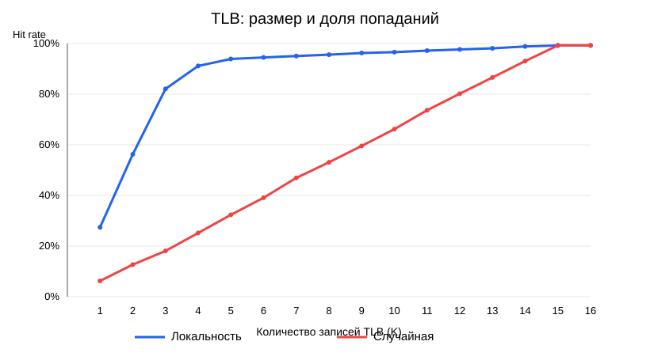

# Практическая работа №10: Страничная организация и TLB

**Вариант:** Уровни **A + B + C** (все задания)  
**Репозиторий:** [ibrodevs/OS-P-10](https://github.com/ibrodevs/OS-P-10)  
**Студент:** Иброхим Абдраимов (`ibrodevs`)  
**Группа:** CS-32-24  

---

## Цель работы

Реализовать перевод логических адресов в физические через таблицу страниц, обработать отсутствие страниц, смоделировать TLB с алгоритмом LRU и оценить эффективное время доступа к памяти. Для уровня C — исследовать механизмы Linux: `/proc/self/maps`, `/proc/self/pagemap`, разделяемые `mmap`, реальные page faults, локальность доступа, влияние TLB и Transparent Huge Pages (THP).

## Обоснование выбора окружения

- **Python 3.10+** — реализация симулятора; стандартной библиотеки достаточно, установка пакетов не требуется.
- **Linux + GCC/Clang + make** — программы варианта C и интерфейсы `/proc`, `getrusage`, `mmap`, `madvise`, `perf`.
- **Размер виртуальной страницы симулятора:** строго **1024 Б**; **виртуальное адресное пространство:** 16 КБ, страницы **0…15**.
- **Размер страницы реальной Linux-системы:** определяется через `sysconf(_SC_PAGESIZE)`, часто **4096 Б**; его нельзя путать с учебными 1024 Б.
- **Права доступа:** чтение *номера физического кадра* (PFN) в `/proc/self/pagemap` обычно требует `CAP_SYS_ADMIN`. Простого `root` в контейнере может быть недостаточно. Остальные C-эксперименты, как правило, не требуют root, кроме настройки cgroup/perf.

---

## Структура репозитория

```text
OS-P-10/
├── README.md                      # Основной отчёт, как в OS-P-1
├── RESULTS.md                     # Измерения и методология проверки
├── pagetable.txt                  # 16 записей: страница -> кадр / отсутствует
├── refs.txt                       # 30 логических адресов, первые три контрольные
├── translate.py                   # Перевод адресов и страничные отказы (A)
├── tlb.py                         # TLB (LRU), EAT, двухуровневая таблица (B)
├── analysis.py                    # Строки с локальностью, hit rate и график (B)
├── figures/
│   └── tlb_hit_rate.svg           # Готовый график (B)
├── tests/
│   └── test_translate.py          # Автотесты A и B
├── c/                              # Практические Linux-эксперименты (C)
│   ├── Makefile
│   ├── pagemap_demo.c
│   ├── shared_mmap.c
│   ├── faults_bench.c
│   ├── locality_bench.c
│   └── tlb_bench.c
└── .github/workflows/tests.yml    # Автоматический прогон Python и C в CI
```

---

## Инструкция по запуску и проверке

В корневом каталоге проекта:

```bash
# Задание A: ручная/программная трансляция, страничные отказы
python3 translate.py

# Задание B: TLB, hit/miss, EAT, двухуровневая таблица
python3 tlb.py --size 3 --walk 1200
python3 analysis.py  # Создаёт / обновляет figures/tlb_hit_rate.svg

# Тесты (не нужен pytest)
python3 -m unittest discover -s tests -v

# Задание C (Linux)
make -C c
./c/bin/pagemap_demo
./c/bin/shared_mmap
./c/bin/faults_bench --mib 32 --rounds 2
./c/bin/faults_bench --mib 32 --rounds 2 --random
./c/bin/locality_bench 2048
./c/bin/tlb_bench --mib 64 --stride 64 --rounds 10
./c/bin/tlb_bench --mib 64 --stride 4096 --rounds 10
./c/bin/tlb_bench --mib 64 --stride 4096 --rounds 10 --huge
```

Параметры TLB: `--size K`, `--refs путь`, `--table путь`. Для графика: `--length N --seed S --output файл.svg`. C-программы используют ограниченные размеры по умолчанию, повышать объёмы стоит только на изолированной Linux VM.

---

## Выполнение задания — вариант A

### 1. Ручной перевод трёх адресов

Таблица для проверки: `0 → 5`, `1 → 2`, `2 → 7`, `3 → 0`, **страница 4 отсутствует**. Страница занимает **1024 Б**, поэтому

```text
page   = logical_address // 1024
offset = logical_address % 1024
physical_address = frame * 1024 + offset
```

| Адрес | Вычисление страницы | Смещение | Кадр | Физический адрес |
|---:|---|---:|---:|---|
| **1200** | `1200 // 1024 = 1` | `1200 % 1024 = 176` | 2 | `2 × 1024 + 176 = 2224` |
| **3100** | `3100 // 1024 = 3` | `3100 % 1024 = 28` | 0 | `0 × 1024 + 28 = 28` |
| **5000** | `5000 // 1024 = 4` | `5000 % 1024 = 904` | отсутствует | **Страничный отказ** |

### 2. Реализация трансляции

`translate.py` проверяет диапазон `0…16383`, читает `pagetable.txt`, находит кадр и умножает номер кадра на размер страницы. При отсутствующей странице порождает `PageFault`, а CLI **сообщает о страничном отказе, не завершая программу с ошибкой**. За границами 16 КБ — отдельная ошибка допустимости адреса.

### 3. Сверка с `refs.txt`

Первые обращения: `1200`, `3100`, `5000`. Получены соответственно `2224`, `28`, `СТРАНИЧНЫЙ ОТКАЗ`. Они **полностью совпадают** с ручным расчётом. В файле `refs.txt` 30 обращений, из которых 2 приходятся на отсутствующую страницу 4.

### 4. Почему размер страницы выбирают степенью двойки?

При размере **1024 = 2¹⁰** логический адрес можно разделить на старшие биты номера страницы и **10 младших бит смещения**. Вместо дорогих операций деления и остатка достаточно битового сдвига и маски: `page = addr >> 10`, `offset = addr & 1023`. Степень двойки упрощает аппаратную трансляцию, выравнивание и адресацию.

---

## Выполнение задания — вариант B

### 1. TLB с LRU, регистрация hit/miss

`TLB` хранит пары `страница → кадр` с ограничением на **K** записей, используя `OrderedDict`. При **hit** страница перемещается в конец списка как недавно использованная; при **miss** выполняется поиск в таблице, при заполнении TLB вытесняется самая давно использованная запись. **Отсутствующая страница никогда не помещается в TLB** и регистрируется отдельным page fault. Кэш полностью программный — аппаратный TLB процессора не изменяется.

Результат `refs.txt` (30 адресов; статистика hit/miss включает два обращения, завершившиеся page fault):

| K | Hits | Misses | Page faults | Hit rate |
|---:|---:|---:|---:|---:|
| 1 | 3 | 27 | 2 | 10,00% |
| 2 | 7 | 23 | 2 | 23,33% |
| 3 | 15 | 15 | 2 | 50,00% |
| 4 | 21 | 9 | 2 | 70,00% |
| 8 | 23 | 7 | 2 | 76,67% |

### 2. Эффективное время доступа (EAT)

Условия модели: обращение к памяти **100 нс**, поиск в TLB **10 нс**. При попадании в TLB нужен доступ к данным, при промахе — доступ к **одноуровневой таблице страниц + к данным**:

```text
EAT = h × (10 + 100) + (1 − h) × (10 + 100 + 100)
    = 210 − 100h наносекунд
```

| Доля попаданий h | EAT (без page faults) |
|---:|---:|
| 0% | 210 нс |
| 50% | 160 нс |
| 90% | 120 нс |
| 100% | 110 нс |

На `refs.txt` при **K=3** измеренная доля hit = **50%**, условное EAT = **160 нс**. При **K=4** hit = **70%**, EAT = **140 нс**. **Важно:** в трассе есть 2 page faults; время обработки отказов не задано, поэтому расчёт EAT — упрощённая оценка **без времени обслуживания page fault**, а не реальное измеренное время исполнения.

### 3. График «размер TLB → доля попаданий»

`analysis.py` с фиксированным `seed=11` генерирует **2000 адресов** в двух сценариях: (1) **90% обращений** идут к трём горячим страницам, (2) равномерный выбор из 15 загруженных страниц. Страница 4 исключена, чтобы сравнивать именно эффективность TLB, а не ошибки загрузки.



| K | С локальностью | Случайная строка |
|---:|---:|---:|
| 1 | 27,40% | 6,25% |
| 2 | 56,25% | 12,70% |
| 3 | 82,10% | 18,10% |
| **4** | **91,15%** | **25,20%** |
| 8 | 95,60% | 53,10% |
| 15 | 99,25% | 99,25% |

**Вывод:** при выраженной локальности достаточно TLB на 3–4 записи, чтобы получать высокую долю попаданий. Равномерное случайное обращение затрагивает множество страниц и требует TLB большего размера. Даже когда K равно числу разных страниц, начальные обращения — misses (*cold misses*).

### 4. Двухуровневая таблица страниц

Для **16 виртуальных страниц** номер страницы занимает 4 бита. Он разделён на **2 бита внешнего индекса** и **2 бита внутреннего индекса** (4 × 4 записи), плюс 10 бит смещения:

```text
 14-битный логический адрес
┌────────────────┬────────────────┬──────────────────────────────┐
│ Внешний индекс │ Внутр. индекс  │        Смещение             │
│     2 бита     │     2 бита     │        10 бит               │
└────────────────┴────────────────┴──────────────────────────────┘
         ↓                ↓                         ↓
   Каталог таблиц → Таблица 2-го уровня → Кадр + смещение
```

Класс `TwoLevelPageTable` действительно создаёт две ступени индексации и выполняет `walk()`. Для адреса **1200**: индексы `(0, 1)`, смещение `176`, результат **2224**. **Без TLB** при попадании в память требуются **3 чтения памяти**: запись таблицы 1-го уровня, запись таблицы 2-го уровня, данные. Для одноуровневой таблицы — **2 чтения**. При промахе в TLB двухуровневый EAT = `310 − 200h` нс; при hit = 110 нс. При page fault число чтений может быть меньше, зато требуется обработка ошибки.

---

## Выполнение задания — вариант C (Linux)

### 1. Реальные адреса `/proc/self/maps` и `/proc/self/pagemap`

`c/pagemap_demo.c` получает адрес реальной переменной, ищет её отображение в `/proc/self/maps`, вычисляет смещение записи в pagemap через **реальный** размер страницы, читает бит `present` и номер PFN (если доступен). Физический адрес вычисляется как `PFN × page_size + offset`. Если PFN замаскирован ядром — выводится предупреждение. **CAP_SYS_ADMIN необходим для получения PFN в современных Linux**, и `sudo` без этой capability недостаточен.

### 2. Разделяемые страницы в двух процессах

`c/shared_mmap.c` создаёт временный файл, отображает его через `MAP_SHARED`, выполняет `fork()`; дочерний процесс делает *второе* отображение файла на отличающийся виртуальный адрес, записывает `99`, родитель после `waitpid()` читает **99**. Этим подтверждаются общие изменения содержимого одной backing-страницы. Встроенная проверка физического PFN здесь не выполняется: для прямого сопоставления PFN в **обоих процессах** нужен разрешённый доступ к их `pagemap`.

### 3. Minor / major faults и пробуксовка

`c/faults_bench.c` создаёт файловое отображение `mmap` указанного размера, читает страницы последовательным или псевдослучайным (перемешанным шагом) порядком и измеряет **`ru_minflt` / `ru_majflt`** с помощью `getrusage`, дополнительно читает `/proc/self/stat` (поля **10 и 12**). Для сравнения запускать **два отдельных процесса** с одинаковыми `--mib` и `--rounds`, меняя `--random`; результаты зависят от page cache, диска, RAM и настроек swap.

**Безопасная демонстрация memory pressure:** в отдельной тестовой Linux VM, где разрешены cgroup v2 и настроен swap, постепенно ограничить `memory.max` для специально созданной cgroup и сравнить `faults_bench --mib 32` с `--mib 64` и `--mib 128`, контролируя `memory.events`, `memory.stat`, `memory.swap.current` и время выполнения. Размер рабочей области должен постепенно превышать **доступный бюджет памяти**, но не память хоста. **Major faults и резкое замедление не гарантированы:** страницы могут оставаться в page cache, а при отсутствии swap процесс может получить OOM-kill. Поэтому реальная пробуксовка на конкретной машине считается *подтверждённой только по её измерениям*, не по симуляции.

`ulimit -v` ограничивает **виртуальный адресный объём** процесса; сам по себе он может вызвать `ENOMEM`, но **не доказывает** возникновение страничной пробуксовки и не эквивалентен `cgroup memory.max`.

### 4. Обход строк / столбцов

`c/locality_bench.c` выделяет матрицу байтов, проходит **все элементы ровно один раз** в порядке строк и затем столбцов; сверяет равные контрольные суммы. При обходе строк последовательные элементы обычно лежат в соседних адресах и кэш-линиях; при обходе столбцов каждый шаг перемещается на длину строки. Это ухудшает пространственную локальность **CPU cache** и может увеличить TLB misses при достаточно большой матрице. Разница во времени не является чистым измерением TLB: влияет и кэш процессора.

### 5. TLB misses и huge pages

`c/tlb_bench.c` предварительно касается каждой страницы, затем многократно читает массив с регулируемым шагом (`--stride`). Для оценки TLB на Linux использовать счётчики `perf`:

```bash
perf stat -e dTLB-loads,dTLB-load-misses -- ./c/bin/tlb_bench --mib 64 --stride 4096 --rounds 100
perf stat -e dTLB-loads,dTLB-load-misses -- ./c/bin/tlb_bench --mib 64 --stride 4096 --rounds 100 --huge
```

`--huge` вызывает `madvise(MADV_HUGEPAGE)` — это **запрос THP, а не гарантия** выделения огромных страниц. Фактическое выделение можно проверять по `/proc/<pid>/smaps` (поле `AnonHugePages`) во время работы процесса. На некоторых CPU событие `dTLB-load-misses` недоступно, а `perf` может блокироваться через `perf_event_paranoid`. В таком случае оставить результат как *не измерено*, а не придумывать счётчики. `MADV_HUGEPAGE` не то же самое, что резервирование HugeTLB (`MAP_HUGETLB`).

---

## Контрольные вопросы

**1. Почему без TLB страничная организация замедлила бы каждое обращение к памяти вдвое и более?**  
Без TLB нужно сначала прочитать таблицу страниц из оперативной памяти, чтобы узнать номер кадра, и только затем прочитать/записать данные. Для одноуровневой таблицы это минимум **2 обращения к RAM вместо 1**; для двухуровневой — минимум **3**. TLB хранит часто используемые трансляции в быстром ассоциативном кэше и позволяет избежать повторного обращения к таблице.

**2. Что хранится в записи таблицы страниц помимо номера кадра?**  
В зависимости от архитектуры: бит присутствия/валидности (`present/valid`), права чтения/записи/исполнения (`R/W/X` или `NX`), биты accessed/referenced и dirty, признаки user/supervisor, global, настройки кэширования и служебная информация для выгруженных страниц. Конкретная структура определяется CPU и операционной системой.

---

## Ключевые результаты

- **A:** `1200 → 2224`, `3100 → 28`, `5000 → страничный отказ` — программа совпадает с ручным расчётом.
- **B:** реализация TLB LRU, таблица hit/miss, модель EAT и реальная двухуровневая индексация; готовый SVG-график.
- **C:** исходники **5 Linux-экспериментов**; тесты с реальными измерениями без выдуманных привилегий/major faults; описаны особенности безопасности и воспроизводимости.
- **Автопроверка:** `python3 -m unittest discover -s tests -v`; сборка C через `make -C c`.

## Вывод

Страничная организация позволяет работать с виртуальными адресами независимо от физического размещения страниц, но требует дополнительных обращений к таблицам страниц. TLB сокращает эту цену: особенно при локальности обращений. Двухуровневая таблица экономит память под разрежённое адресное пространство ценой более дорогого обхода при TLB-miss. Реальные Linux-эксперименты показывают важность разграничения симуляции, работы CPU cache, TLB и дисковой подкачки: **время работы и major faults зависят от окружения**, а номер физического кадра не всегда раскрывается ядром.

Полные воспроизводимые результаты и ограничения экспериментальной среды — в [RESULTS.md](RESULTS.md).
